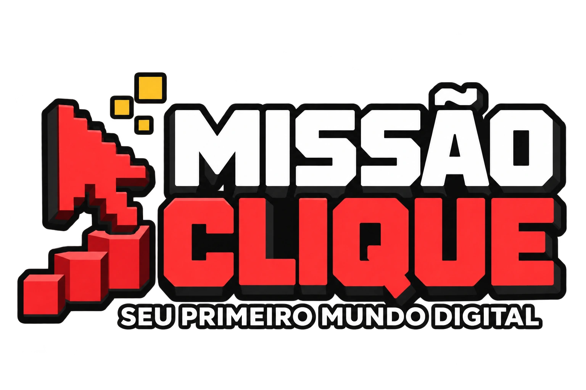

# Missão Clique



Uma apresentação interativa de informática básica para estudantes do 7º ano. A turma aprende a usar o computador em três fases, com missões práticas e uma estética inspirada em jogos de blocos e no universo visual de Roblox.

**[Abrir a apresentação](https://art988.github.io/missaoClique/)**

## O que a turma aprende

1. **Aprenda os controles:** partes do notebook, energia, mouse, touchpad, teclado e escrita.
2. **Explore a tela:** área de trabalho, programas, menu Iniciar e janelas.
3. **Organize seu inventário:** pastas, arquivos, salvamento, busca e recuperação pela Lixeira.

São 30 telas. O roteiro prevê fases de 40, 30 e 40 minutos, com mais 10 minutos para dúvidas e ajustes. Os treinos na apresentação acompanham atividades reais no Windows e no Bloco de Notas.

## Como usar

- Use as setas esquerda e direita para navegar.
- **M** abre o mapa com todas as telas.
- **N** mostra as notas para conduzir a aula. O painel aparece na projeção enquanto estiver aberto.
- **F** alterna a tela cheia, quando o navegador permite.
- **Home** e **End** levam à primeira e à última tela.

As teclas continuam disponíveis para escrever quando o campo de digitação está selecionado.

Na última tela, **Jogar Novamente** limpa as conquistas, a autoavaliação e os treinos e volta ao início. Assim, o próximo aluno pode usar o mesmo computador. Os arquivos reais criados no computador continuam intactos.

As conquistas e a autoavaliação ficam apenas no navegador em uso, quando o armazenamento local está disponível. Não há cadastro, ranking ou sincronização entre computadores. Os treinos são temporários e voltam ao início ao recarregar a página.

## Uso sem internet

Baixe o arquivo [`downloads/missao-clique-offline.html`](downloads/missao-clique-offline.html) e abra no navegador. Ele já inclui os estilos, as interações e as imagens. Pode copiar só esse arquivo para outro computador ou pendrive.

Antes de passar o computador ao próximo colega, salve o texto criado no Bloco de Notas e clique em **Jogar Novamente** na apresentação.

## Organização do projeto

```text
index.html                  Página inicial
styles.css                  Estilos e identidade visual
app.js                      Telas, navegação e exercícios
assets/                     Ilustrações e logo
downloads/                  Cópia completa para uso offline
LICENSE                     Licença MIT
```

O site funciona diretamente no navegador com HTML, CSS e JavaScript. Para abrir a versão separada localmente, mantenha os arquivos juntos e abra `index.html`.

## Publicação

O GitHub Pages publica a partir da raiz da branch `main`. Alterações enviadas a essa branch atualizam o site após a publicação terminar. O arquivo `.nojekyll` mantém a publicação dos arquivos estáticos.

Se editar `index.html`, `styles.css`, `app.js` ou as imagens, atualize também a cópia completa em `downloads/` antes de distribuir uma nova versão offline.

## Créditos e licença

Conteúdo baseado no roteiro **Introdução ao Mundo Digital** fornecido para o curso. Criação educacional independente, sem vínculo oficial com Roblox.

O repositório utiliza a [licença MIT](LICENSE).
